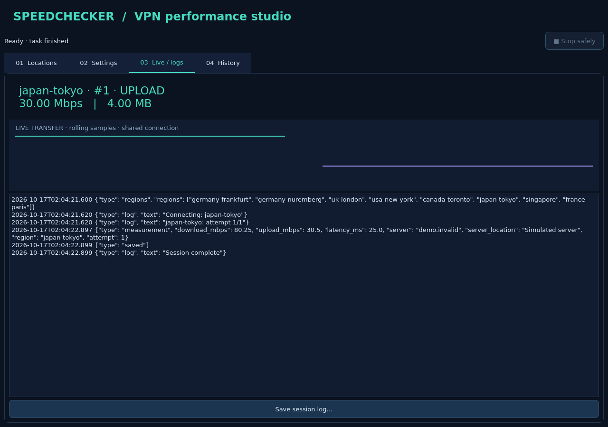

# Speedchecker — تست سرعت لوکیشن‌های VPN


پروژه را کلون کنید، فقط وابستگی‌ها را نصب کنید و `app.py` را اجرا کنید.
**خود پروژه در venv نصب نمی‌شود** و نیازی به `pip install .` نیست.

## نصب و اجرا

پایتون ۳٫۱۰ یا جدیدتر و محیط دسکتاپ لازم است:

```sh
git clone https://github.com/humorheatyt/speedchecker.git
cd speedchecker
python -m venv .venv
source .venv/bin/activate
# ویندوز PowerShell: .venv\Scripts\Activate.ps1
pip install -r requirements.txt
python app.py
```

در لینوکس‌های کمینه ممکن است کتابخانه‌های سیستمی Qt لازم باشند. برای Debian/Ubuntu:

```sh
sudo apt install libgl1 libegl1 libopengl0 libxcb-cursor0 libxkbcommon-x11-0 libdbus-1-3
```

رابط با PyQt6، تم تیره و چهار تب ساخته شده است. متن رابط فعلاً انگلیسی است.
برای تست بدون اینترنت و تغییر شبکه، گزینهٔ **Offline demo (synthetic)** را فعال کنید.
تمام نتایج این حالت با برچسب DEMO از نتایج واقعی جدا می‌شوند.

برای استفادهٔ واقعی باید ExpressVPN نصب، فعال و وارد حساب شده باشد و دستور
`expressvpnctl` در PATH باشد. نسخهٔ آن باید دستورات `get regions`،
`get connectionstate`، `connect <alias>` و `disconnect` را پشتیبانی کند.
اشتراک یا برنامهٔ ExpressVPN همراه پروژه نیست.

**نیازی به نصب جداگانهٔ speedtest نیست.** نسخهٔ متن‌باز `speedtest-cli 2.1.3`
به همراه مجوز Apache-2.0 داخل `vendor/` قرار دارد و هنگام کلون دریافت می‌شود.
این کلاینت HTTP جامعهٔ متن‌باز است، نه باینری اختصاصی Ookla؛ نتایج و دسترسی
به سرویس ممکن است با برنامهٔ رسمی متفاوت باشد.

## امکانات و روش استفاده

### لوکیشن‌ها
- ابتدا **Load ALL VPN locations** را بزنید؛ فهرست کامل aliasها از ExpressVPN گرفته می‌شود.
- جست‌وجوی لوکیشن، گروه‌بندی بر اساس پیشوند alias، ترتیب اصلی سرویس‌دهنده،
  الفبایی و معکوس، تصادفی، ترتیب گروه لوکیشن یا ترتیب فایل JSON وجود دارد.
- گروه‌بندی از اسم alias استنباط می‌شود؛ کاتالوگ رسمی قاره‌های ExpressVPN نیست.
- با تیک زدن سرورها یک برنامهٔ تست بسازید؛ Check visible همهٔ ردیف‌های فیلتر فعلی را انتخاب می‌کند.
- **Test highlighted location** فقط لوکیشن هایلایت‌شده را تست می‌کند؛ عنوان گروه سرور نیست.
- تست دسته‌ای بر اساس تیک‌های ردیف‌های قابل مشاهده اجرا می‌شود؛ فیلتر را قبل از شروع بررسی کنید.
- برنامهٔ JSON ابتدا با فهرست واقعی تطبیق داده می‌شود؛ اگر هر ورودی نامعتبر باشد، وارد نمی‌شود.

نمونهٔ JSON با alias واقعی مطابق خروجی نسخهٔ ExpressVPN خودتان:

```json
{"locations": [
  {"country": "Germany", "city": "Frankfurt", "region": "germany-frankfurt"},
  {"country": "Japan", "city": "Tokyo", "region": "japan-tokyo"}
]}
```

### تنظیمات
- تعداد تکرار هر لوکیشن و تعداد تست‌های همزمان روی **همان لوکیشن**، از ۱ تا ۳۲ worker.
- timeout هر دستور VPN، انتظار اتصال/قطع، سقف زمان کل تست و timeout سوکت HTTP.
- وقفه بین لوکیشن‌ها، تست اولیه بدون VPN و اجازهٔ صریح قطع VPN از قبل متصل.
- شناسهٔ عددی سرور اندازه‌گیری speedtest؛ خالی باشد، نزدیک‌ترین endpoint خودکار انتخاب می‌شود.
  سرور اندازه‌گیری با لوکیشن VPN فرق دارد.
- واحد سرعت: Mbps، MB/s، Kbps، KB/s، Gbps، GB/s، KiB/s و MiB/s.
- واحد حجم انتقال: B، KB، MB، GB، KiB و MiB.
- تنظیمات معمول ذخیره می‌شوند؛ اجازهٔ قطع اتصال قبلی عمداً ذخیره نمی‌شود.

**محدودیت شبکه:** یک میزبان معمولی فقط یک تونل ExpressVPN فعال دارد؛ بنابراین
لوکیشن‌های متفاوت به‌ترتیب تست می‌شوند. همزمانی برای چند اندازه‌گیری روی همان
تونل است و پهنای باند بین آن‌ها تقسیم می‌شود. برای مقایسهٔ استاندارد worker=1
مناسب‌تر است. تست همزمان لوکیشن‌های متفاوت به VM یا شبکه‌های مستقل نیاز دارد
و در این نسخه پیاده نشده است.

### نمایش زنده و لاگ
- نمونه‌های سرعت دانلود/آپلود، حجم انتقال، نمودار متحرک، لوکیشن و شمارهٔ تلاش نمایش داده می‌شوند.
- در حالت همزمان، هر نمونه مربوط به یک تلاش است، نه مجموع سرعت همهٔ workerها.
- حجم آپلود زنده، بایت تحویل‌شده به پشتهٔ HTTP است؛ تضمین دریافت در مقصد نیست.
- دستورهای اجراشده، stdout و stderr، metadata سرور اندازه‌گیری، نتیجه‌ها و خطاها ثبت می‌شوند.
- رخدادهای پیشرفت هم در فایل لاگ ذخیره می‌شوند؛ برای خوانایی، هر نمونه وارد پنجرهٔ متن لاگ نمی‌شود.
- لاگ کامل نشست قابل ذخیره است؛ ۵۰۰۰ خط آخر در پنجره نگه داشته می‌شود.

### تاریخچه
- SQLite ماندگار برای هر تلاش، نتیجهٔ موفق، خطا یا لغو، latency و endpoint و تنظیمات.
- خطای اتصال با attempt=0 ثبت می‌شود؛ تلاش‌های هنوز اجرا‌نشده رکورد نتیجه ندارند.
- فیلتر وضعیت، واقعی/دمو، جست‌وجوی تاریخ/لوکیشن/endpoint/خطا و حداقل دانلود بر حسب Mbps.
- مرتب‌سازی ستون‌ها، از جمله سرعت و تأخیر عددی، و خروجی CSV یا JSON از موارد فیلترشده.
- دادهٔ خام و خروجی همیشه Mbps است؛ تغییر واحد فقط نمایش را تغییر می‌دهد.

مسیر تاریخچه: `~/.speedchecker/history.sqlite3`

مسیر لاگ‌ها: `~/.speedchecker/logs/`

تنظیمات با QSettings در محل استاندارد سیستم‌عامل ذخیره می‌شوند.
لاگ‌ها ممکن است اطلاعات endpoint و شبکه داشته باشند؛ پیش از اشتراک بررسی‌شان کنید.
حذف خودکار لاگ وجود ندارد؛ فایل‌های قدیمی را در صورت نیاز پاک کنید.

## ایمنی و توقف

بدون تأیید صریح، اتصال VPN موجود قطع نمی‌شود. اگر اجازه بدهید، اتصال قبلی
**بازگردانده نمی‌شود**. اتصال‌های ساخته‌شده پس از تست یا خطا قطع می‌شوند.
اگر قطع اتصال شکست بخورد، برنامه تست سرور بعدی را شروع نمی‌کند.

دکمهٔ Stop فرآیندهای speedtest متعلق به برنامه را متوقف می‌کند، تلاش تازه شروع
نمی‌کند و منتظر cleanup محدود به timeout می‌ماند. تا پایان cleanup پنجره بسته نمی‌شود.
بستن اجباری فرآیند یا قطع برق نمی‌تواند قطع VPN را تضمین کند.
همزمان چند نمونهٔ واقعی از برنامه یا ابزارهای تغییر VPN دیگر را اجرا نکنید.

## اجرای اختیاری خط فرمان

```sh
python app.py --cli locations.json --demo -s -r 2
python app.py --cli locations.json -s -r 3 --connection-timeout 60 --speedtest-timeout 180
python app.py --cli --help
```

backend پیش‌فرض داخلی است. فقط برای سازگاری، در صورت نصب قبلی باینری اختصاصی
Ookla می‌توانید `--backend ookla --accept-license` بدهید.
گزارش CLI فایل JSON مستقل است و وارد SQLite رابط گرافیکی نمی‌شود.
نام داخلی `src/vpnchecker` برای سازگاری حفظ شده، اما نام پروژه و برنامه Speedchecker است.

## تست‌ها

```sh
pip install -r requirements.txt ruff
PYTHONPATH=src QT_QPA_PLATFORM=offscreen python -m unittest discover -s tests -v
ruff check .
ruff format --check .
```

تست‌های خودکار از VPN دمو و فرآیندهای ساختگی جداشده استفاده می‌کنند: خطا،
timeout، لغو، سقف همزمانی، تاریخچه و cleanup را بررسی می‌کنند.
تست Qt به کتابخانه‌های native نیاز دارد و در نبودشان با دلیل مشخص skip می‌شود.
صحت اتصال واقعی ExpressVPN و دسترسی speedtest.net باید روی دسکتاپ مقصد هم
بررسی شود؛ محیط sandbox به‌تنهایی تأییدکنندهٔ سرعت یا اتصال واقعی نیست.
